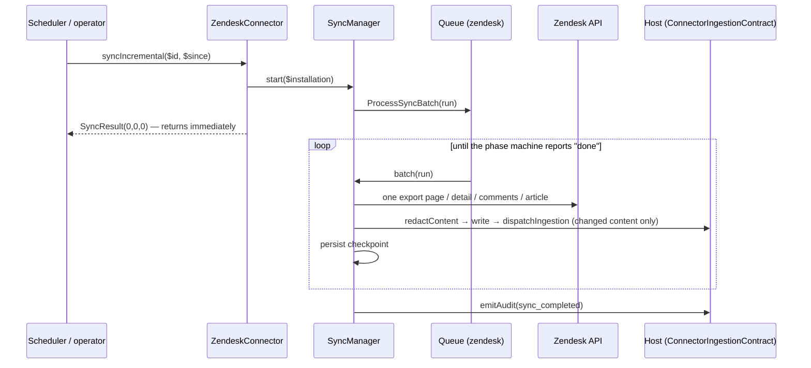

# Architecture

This page explains how the Zendesk connector is put together and why. Read the [README](../README.md) first for the user-facing picture.

## Components

| Component | Responsibility |
|---|---|
| `ZendeskServiceProvider` | Merges config, loads migrations, registers the connector in `connectors.built_in`, publishes config and icon |
| `ZendeskConnector` | The `ConnectorInterface` surface plus four optional capabilities: `SupportsCredentialForm`, `SupportsConnectionSettings`, `DeclaresProvenance`, `SupportsSourceAcl` |
| `Http\ZendeskClient` | The only class that talks to Zendesk. Read-only (`GET`), authenticated per installation, capped, retried, streamed |
| `Http\UrlPolicy` | Validates the account subdomain, every URL, and the attachment host allow-list; pins DNS to public addresses |
| `Exceptions\ZendeskApiException` | A failed HTTP answer reduced to status, `Retry-After` and sanitised field names — never the upstream body |
| `Sync\SyncManager` | Starts scans and advances the phase machine one step at a time |
| `Sync\ProcessSyncBatch` / `Sync\StartSync` | Queue jobs: one bounded batch (re-dispatching itself), and the scheduler entry point |
| `Sync\DocumentImporter` | Turns Zendesk objects into KB documents, attachments and deletions |
| `Sync\SyncRun` / `Sync\SourceState` | Eloquent models for scan state and per-object delivery state |
| `Support\Markdown` | Pure renderers: ticket, user, organization, article |
| `Support\SourceAccessPolicy` | Zendesk visibility → `SourceAccess` vocabulary |
| `Support\RemoteId` | The `{installation}:{kind}:{id}` identifier format |
| `Tools\ZendeskTools` / `Tools\ZendeskArguments` | The live tool catalog, executor and argument rules |
| `resources/agent-usage.json` | Machine-readable guidance for the orchestrator |

## Data flow of an indexed scan



`syncFull()` and `syncIncremental()` are intentionally identical: the contract's `Carbon $since` cannot express "resume cursor 7 of the ticket export", so the package's own checkpoints are authoritative. The returned `SyncResult` is empty by design — counts are available from `SyncRun::summary()` once the queued scan completes.

## The phase machine

State is a JSON checkpoint on `zendesk_sync_runs`. Each `step()` performs *one* unit of work (one export page, one ticket, one article, a batch of 100 existence checks) and returns the updated checkpoint; `batch()` repeats `step()` until the item or time budget is spent, then re-queues.

```
refresh (tickets → customers → organizations)? ─▶ tickets ─▶ users ─▶ organizations ─▶ articles ─▶ article_check ─▶ (history only) customer_check ─▶ done
```

Reasons for the shape:

- **Small steps** keep a worker timeout cheap: at most one step of work is lost.
- **One step = one external failure domain**, so a `429` or `5xx` always leaves a checkpoint that can be replayed.
- **`transition()` resets per-phase cursors**, so a stale cursor can never leak into the next phase.
- **Phases are skipped, not stubbed**, when the operator disables a content type.

## Why cursor-based incremental exports

Zendesk offers several ways to enumerate tickets. Offset pagination is capped at 100 pages; the search API returns at most 1 000 results; the plain list endpoints are eventually consistent while records change. The cursor-based incremental export is Zendesk's documented mechanism for *"give me everything changed since T"* on large accounts, ordered by update time, and it reports deleted tickets. That is exactly the contract the scan needs, so tickets and users use it; organizations use the time-based incremental export; Help Center articles (not windowed) use cursor pagination.

## Why live tools exist next to the index

An index is a snapshot. A support agent asking *"is ticket #4821 solved?"* needs the present, and a snapshot taken up to a scan interval ago can be wrong in exactly the way that matters. The live tools answer current-state questions; the index answers *"have we seen this before?"*. `agent-usage.json` encodes that split so the orchestrator picks the right mode per question and combines both for *"apply the documented procedure to this ticket"*.

## Decisions and trade-offs

| Decision | Alternative rejected | Why |
|---|---|---|
| Read-only client, `GET` only | Offering write tools (reply, assign, close) | Out of scope for a knowledge connector, and an agent acting on customer-authored text must not be able to mutate the desk |
| Basic-auth API token **and** pre-issued OAuth token | Embedding the OAuth authorization-code flow | Keeps the package free of redirect/consent plumbing the host already owns; the cost is no refresh of expiring tokens (documented) |
| Customers and organizations as documents | Resolving names at query time only | Gives semantic search over account background ("customers on the Enterprise tag who…") without a live call per question |
| Requester not reported in the ticket ACL | Reporting the requester as a reader | The document contains internal notes the requester must never see |
| `untrusted-external` provenance by default | `trusted-internal` like Jira/Confluence | Ticket text is written by customers; an agent reading it with tools in scope is a prompt-injection surface |
| Deletion only on positive evidence | Treating absence or `404` as deletion | Archived tickets and permission changes also look like absence |
| Fingerprint includes the reported ACL | Fingerprint of body only | An ACL change with identical text must still reach the host |
| `UrlPolicy` + DNS pinning for every URL | Trusting `content_url` | Attachment URLs are caller-influenced data; the pin removes the check/connect race |

## Multi-tenancy and multi-account

Every query filters on `tenant_id`; `SyncManager::installation()` and `client()` refuse a tenant mismatch; the sync lock is `zendesk-sync:{tenant}:{installation}`; the path of a stored document contains a hash of the tenant. Several installations (labels) of one tenant import independently, each with its own project key, window and switches.
